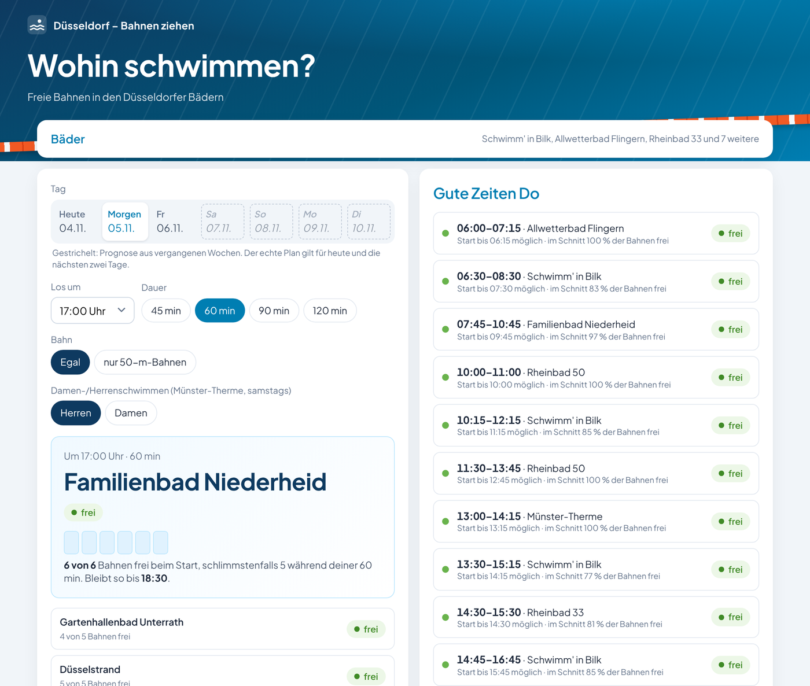

# Düsseldorf – Bahnen ziehen

Wann und wo ist in den Düsseldorfer Hallenbädern Platz zum Bahnenschwimmen? Diese kleine Seite liest
die öffentlichen **Belegungspläne der Bädergesellschaft Düsseldorf** und zeigt:

- **Wohin jetzt?** Das Bad mit den meisten freien Bahnen für deine Startzeit und Schwimmdauer.
  Bei gleicher Ruhe gewinnt das Bad, das in deiner Reihenfolge weiter oben steht.
- **Gute Zeiten** des Tages, also die ruhigen Abschnitte je Bad.
- **Belegungsplan** aller gewählten Becken nebeneinander, in 15-Minuten-Schritten.
- **Die ganze Woche:** Für heute und die nächsten zwei Tage gilt der echte Plan. Für die vier Tage
  danach gibt es eine Prognose aus den vergangenen Wochen.
- **Nur 50-m-Bahnen**, wenn das Rheinbad 50 laut Plan auf 50 m läuft (montags, mittwochs und
  freitags von 8 bis 14 Uhr sind es 25-m-Bahnen).



> Kein offizielles Angebot und ohne Verbindung zur Bädergesellschaft Düsseldorf. Die Daten stammen
> aus <https://www.baeder-duesseldorf.de/belegungsplan/> und sind ohne Gewähr. Kurzfristige
> Änderungen und Aushänge gibt es nur dort und vor Ort.

## So funktioniert es

- **Abruf:** `fetch_baeder.py` (nur Python-Standardbibliothek) holt alle 30 Minuten mit einer
  einzigen Anfrage die Pläne aller Bäder und Becken. Daraus schreibt es `plan.json` für die Seite.
- **Verlauf:** Jeder Abruf speichert den Plan jedes Tages unter `/var/lib/baeder/history/`.
  Das sind etwa 80 KB pro Tag für alle Becken; Dateien älter als 400 Tage werden gelöscht.
- **Prognose:** Für die Tage 4 bis 7 rechnet das Skript den Durchschnitt der freien Bahnen am
  gleichen Wochentag der letzten 6 Wochen. Die erste Prognose erscheint eine Woche nach der
  Installation, verlässlich wird sie nach etwa vier Wochen. Ferien und Feiertage werden nicht
  gesondert behandelt.
- **Bewertung:** Die Seite (`www/index.html`, ohne Abhängigkeiten) rechnet im Browser. *Frei*
  heißt: im Schnitt über die Schwimmdauer mindestens ¾ der Bahnen frei. *Ruhig* heißt: mindestens
  die Hälfte.
- **Öffnungszeiten:** Es zählen nur öffentliche Öffnungszeiten. Letzter Einlass ist eine Stunde vor
  Schließung, und raus aus dem Wasser muss man 15 Minuten vorher.
- **Sonderzeiten:** Die Münster-Therme hat Sonderzeiten, die im Belegungsplan fehlen. Sie stehen
  als feste Regeln in `index.html` (`RULES`):
  - Damenschwimmen am 1., 2. und 4. Samstag im Monat, 17:30–19 Uhr
  - Herrenschwimmen am 3. Samstag im Monat, 17:30–19 Uhr
  - Montags nur Seniorenschwimmen, 11–14 Uhr

  Ändern sich diese Zeiten auf der Website, müssen die Regeln von Hand angepasst werden.

## Installation (Debian / Ubuntu mit systemd)

```bash
git clone https://github.com/alexanderclemen/duesseldorf-bahnen-ziehen.git
cd duesseldorf-bahnen-ziehen
sudo bash install.sh
```

Das legt den Benutzer `baeder` an, kopiert das Skript nach `/opt/baeder` und die Seite nach
`/var/www/baeder`. Dazu kommt ein Timer, der alle 30 Minuten abruft. Der Dienst läuft in einer
systemd-Sandbox und darf nur in `/var/www/baeder` und `/var/lib/baeder` schreiben.

Danach braucht `/var/www/baeder` noch einen Webserver, zum Beispiel
[Caddy](https://caddyserver.com) mit `Caddyfile.example`. Zum schnellen Ausprobieren ohne
Installation:

```bash
python3 fetch_baeder.py www/plan.json      # Verlauf landet dann in /var/lib/baeder, oder:
STATE_DIRECTORY=./history python3 fetch_baeder.py www/plan.json
cd www && python3 -m http.server 8000      # http://localhost:8000
```

## Eigene Auswahl

Auf der Seite unter **Bäder** kannst du Becken an- und abwählen und mit ↑ ↓ in deine Reihenfolge
bringen. Der Browser merkt sich das. Ohne eigene Wahl sind alle Schwimmer- und Sportbecken gewählt.

Eine feste Vorauswahl für alle, die deine Installation öffnen, legst du mit `www/config.json` fest
(siehe `www/config.example.json`). Die Kennungen haben die Form `standort:becken-id` und stehen in
`plan.json` unter `pools[].id`.

## Bitte fair abrufen

Die Pläne ändern sich selten. Bitte ruf sie nicht öfter als alle 30 Minuten ab, wie es der Timer
tut. Wer das Skript ändert, trägt bitte in `USER_AGENT` eine eigene Kontaktadresse ein.

## Lizenz

Code: MIT, siehe [LICENSE](LICENSE). Die Schrift Plus Jakarta Sans steht unter der SIL Open Font
License ([www/fonts/OFL-LICENSE.txt](www/fonts/OFL-LICENSE.txt)).

---

*English:* A small self-hosted page that reads the public lane plans of the Düsseldorf public pools
and recommends when and where to swim laps, with a 7-day view: real plan for 3 days, then a forecast
from past weeks. Python standard library plus one static HTML file. MIT licence.
